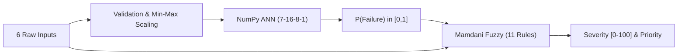

# SC08 — Machine Predictive Maintenance & Fault Priority System
## Final Project Report

---

## 1. Title Page & Project Identity

- **Project Title:** SC08 — Machine Predictive Maintenance & Fault Priority System
- **Course / Subject:** Soft Computing (B.Tech)
- **University:** Galgotias University
- **Team Members:** Shivam Mishra, Anuj, Ayush, Siddharth
- **Repository:** [https://github.com/mishra009shivam/Machine-Predictive-Maintenance-system](https://github.com/mishra009shivam/Machine-Predictive-Maintenance-system)
- **Branch:** `step-7-final-documentation` (based on committed baseline `0f5b55a`)
- **Dataset:** UCI AI4I 2020 Predictive Maintenance Dataset (UCI Repository ID: 601)

---

## 2. Abstract

Unplanned breakdowns in industrial milling machinery cause costly downtime, while overly sensitive alarms waste maintenance resources. This project implements **SC08**, a hybrid Soft Computing decision-support system combining a **hand-coded NumPy Artificial Neural Network (ANN)** (`7 -> 16 -> 8 -> 1`) with a **hand-coded NumPy Mamdani Fuzzy Inference System** (11 rules, Centroid defuzzification), deployed via a **Streamlit** web application (`app.py`). Evaluated on the **AI4I 2020** dataset (`2,000` held-out test records, `68` failures), the ANN achieves higher failure recall (`0.9118`, `62/68` detected) than a deterministic Matzka (2020) fixed-alarm baseline (`0.8676`, `59/68` detected), but produces more false alarms (`231` vs. `22` FP; precision `0.2116` vs. `0.7284`). Downstream, the fuzzy layer translates ANN probability, tool wear, and spindle torque into an interpretable `0–100` Severity Index and `LOW` / `MEDIUM` / `HIGH` / `URGENT` priority.

---

## 3. Introduction

Predictive maintenance aims to detect equipment degradation before catastrophic failure while avoiding unnecessary inspections. Purely data-driven classifiers output raw probabilities without physical context, whereas rigid threshold rules miss subtle multi-sensor interactions. Soft Computing addresses this by pairing neural pattern recognition with fuzzy linguistic reasoning.

---

## 4. Problem Statement

Given 6 raw operational readings from a milling machine (`Type`, `Air temperature [K]`, `Process temperature [K]`, `Rotational speed [rpm]`, `Torque [Nm]`, `Tool wear [min]`), how can we:
1. Estimate the statistical probability of machine failure under severe class imbalance (`3.39%` failure rate), and
2. Translate that probability alongside physical degradation (`Tool wear`, `Torque`) into an explainable severity score and actionable maintenance priority?

---

## 5. User & Practical Decision Supported

- **Target Users:** Factory maintenance operators, reliability engineers, and coursework reviewers.
- **Decision Supported:** Deciding whether to continue normal operation (`LOW`), schedule maintenance within 2–3 days (`MEDIUM`), act within 24 hours (`HIGH`), or stop the machine immediately (`URGENT`), backed by transparent fuzzy rule activations.

---

## 6. Objectives

1. Preprocess and normalize the AI4I 2020 dataset without data leakage (`norm_params.json`).
2. Implement a pure NumPy `7 -> 16 -> 8 -> 1` ANN with class-weighted Binary Cross-Entropy.
3. Implement a pure NumPy Mamdani Fuzzy Inference System with 11 interpretable rules.
4. Compare the ANN fairly against a deterministic fixed-alarm baseline on identical validation (`800`) and test (`2,000`) records.
5. Deliver an interactive Streamlit application (`app.py`) with validation, explainability, and unit tests.

---

## 7. Dataset Source, Licence & Description

- **Source:** UCI Machine Learning Repository, Dataset ID 601 (Matzka, S., 2020, IEEE AI4I), **CC BY 4.0** (`data/raw/ai4i2020.csv`).
- **Size:** `10,000` records, `14` columns, `0` missing values.
- **Class Distribution:** `339` failures (`~3.39%`), `9,661` healthy (`~96.61%`).
- **Features Used (6 raw → 7 encoded):** `Type` (`L` 50%, `M` 30%, `H` 20%), `Air temperature [K]`, `Process temperature [K]`, `Rotational speed [rpm]`, `Torque [Nm]`, `Tool wear [min]`.
- **Target:** `Machine failure` (`0` or `1`). Sub-failure flags (`TWF`, `HDF`, `PWF`, `OSF`, `RNF`) are excluded from ANN inputs to prevent leakage.
- **Critical Limitation:** AI4I 2020 is synthetic and contains **no vibration sensor**; `Torque [Nm]` is mechanical spindle torque, never a vibration proxy.

---

## 8. Data Preparation & Assumptions

From `src/preprocessing.py` and `data/processed/norm_params.json`:
1. Drop identifiers (`UID`, `Product ID`).
2. One-hot encode `Type` (`Type_M`, `Type_H`; `Type_L` as reference).
3. Stratified 80/20 split (`random_state=42`): `8,000` training-side (`7,200` sub-train / `800` stratified validation with `27` failures) and `2,000` held-out test (`68` failures, `1,932` healthy).
4. Min-Max normalization fitted strictly on the `8,000` training-side records:
   - `Air temperature [K]`: `[295.3, 304.5]`
   - `Process temperature [K]`: `[305.7, 313.8]`
   - `Rotational speed [rpm]`: `[1168.0, 2886.0]`
   - `Torque [Nm]`: `[3.8, 76.6]`
   - `Tool wear [min]`: `[0.0, 253.0]`

---

## 9. ANN Architecture & Training Procedure

Implemented in pure NumPy (`src/ann.py`, saved to `results/ann_weights.npz`):
- **Architecture:** `7 -> 16 (ReLU) -> 8 (ReLU) -> 1 (Sigmoid)` (**273 trainable parameters**).
- **Initialization:** He (Kaiming) normal for ReLU layers; Glorot (Xavier) normal for Sigmoid output.
- **Loss Function:** Weighted Binary Cross-Entropy (`w_pos = 28.5203`, `w_neg = 1.0`).
- **Optimization:** Mini-batch SGD (`learning_rate = 0.01`, `batch_size = 64`, `maximum_epochs = 200`, `seed = 42`).
- **Early Stopping:** `10%` stratified validation split (`800` records), `patience = 15`. Best model restored at **epoch 71** (early stopping triggered at epoch 86).

---

## 10. Mamdani Fuzzy Inference System

Implemented in pure NumPy (`src/fuzzy.py`):
- **Inputs (3):** `fault_probability` `[0.0, 1.0]`, `tool_wear_min` `[0, 260]`, `torque_Nm` `[0, 80]`.
- **Rule Base (11 IF–THEN rules):** 9 primary rules (`fault_prob` × `tool_wear` 3×3 grid) + 2 torque modifiers (`R10`: `FP=HIGH & TQ=HIGH -> HIGH`; `R11`: `FP=MED & TQ=HIGH -> MEDIUM`).
- **Inference & Defuzzification:** Mamdani `min`-AND, `max`-aggregation, Centroid (CoG) over `1,000` discrete points on `[0, 100]` (fallback `50.0` if zero area).
- **Priority Thresholds:** `LOW` (`< 33`), `MEDIUM` (`33 <= sev < 60`), `HIGH` (`60 <= sev < 78`), `URGENT` (`>= 78`).

---

## 11. Hybrid Prediction Workflow

---

## 12. Baseline Method

`src/baseline.py` encodes the deterministic Matzka (2020) rules (`HDF OR PWF OR TWF OR OSF`), with `TWF` approximated as `tool_wear_min >= 220` and `RNF` unmodeled. Because these rules mirror the synthetic dataset's generator logic, the baseline acts as a domain-prior oracle rather than an independent factory benchmark.

---

## 13. Experimental Design & Fair Comparison

Verified in `src/compare_baseline.py` and `docs/STEP-4.md`:
- Identical `800` validation and `2,000` test records, with row-index alignment assertions.
- No test-set tuning; ANN weights (`results/ann_weights.npz`) and baseline rules are fixed.
- Continuous ROC-AUC reported for ANN only (`N/A` for discrete baseline).

---

## 14. Validation & Test Results

### 14.1 Performance Metrics (`data/reports/step4_comparison.csv`, `results/metrics.json`)

| Split | Method | Rows | Accuracy | Precision | Recall | F1-Score | Specificity | ROC-AUC |
| :--- | :--- | :---: | :---: | :---: | :---: | :---: | :---: | :---: |
| **Validation** | Fixed alarm baseline | 800 | **0.9875** | **0.7429** | **0.9630** | **0.8387** | **0.9884** | N/A |
| **Validation** | Step 3 ANN | 800 | 0.8838 | 0.2105 | 0.8889 | 0.3404 | 0.8836 | **0.9547** |
| **Test** | Fixed alarm baseline | 2,000 | **0.9845** | **0.7284** | 0.8676 | **0.7919** | **0.9886** | N/A |
| **Test** | Step 3 ANN | 2,000 | 0.8815 | 0.2116 | **0.9118** | 0.3435 | 0.8804 | **0.9581** |

### 14.2 Confusion Matrices & Paired Test Agreement (`docs/STEP-4.md`)

| Split | Method | TP | TN | FP | FN |
| :--- | :--- | :---: | :---: | :---: | :---: |
| **Validation** | Fixed alarm baseline | 26 | 764 | 9 | 1 |
| **Validation** | Step 3 ANN | 24 | 683 | 90 | 3 |
| **Test** | Fixed alarm baseline | 59 | 1,910 | 22 | 9 |
| **Test** | Step 3 ANN | 62 | 1,701 | 231 | 6 |

- **Test Paired Agreement (68 actual failures):** `58` detected by both, `4` ANN-only, `1` baseline-only, `5` missed by both.
- **Test Hybrid Fuzzy Distribution (`results/metrics.json`):** `LOW` `68.05%` (`1,361`), `MEDIUM` `18.60%` (`372`), `HIGH` `6.25%` (`125`), `URGENT` `7.10%` (`142`); severity range `[15.53, 84.47]`.
- **Saved Comparison Plot:** `results/step4_baseline_vs_ann.png`.

---

## 15. Results Interpretation

- **Sensitivity vs. False Alarms:** On the test set, the ANN detects more failures (`62` vs. `59`, recall `0.9118` vs. `0.8676`) due to class-weighted BCE (`w_pos ≈ 28.52`) and the `0.50` threshold, but generates `231` false positives vs. `22` for the baseline (precision `0.2116` vs. `0.7284`).
- **No Universal Winner:** The baseline has higher accuracy, precision, and F1; the ANN is not automatically the better practical choice. Selection depends on the relative cost of missed failures ($C_{\text{FN}}$) versus unnecessary inspections ($C_{\text{FP}}$).
- **Threshold Implications (`results/threshold_decision_analysis.json`):** Validation threshold sweeps show `0.90` maximizes F1 (`0.6207`, `FP=13`, `FN=9`), whereas `0.50` prioritizes recall (`0.8889`, `FP=90`, `FN=3`).

---

## 16. Streamlit Application

`app.py` (Product V1) provides:
- 6 raw input controls (`torque_Nm` capped at `80.0`, `tool_wear_min` capped at `260.0`),
- Independent ANN Threshold Decision Banner ($\tau = 0.50$),
- Metric cards (`fault_probability`, `severity_index`, `priority`), progress gauge, recommendation box, and fired-rule explainability,
- Missing-model `FileNotFoundError` handling (`st.error` + `st.stop()`).

---

## 17. Testing & Verification Evidence

- **Step 1 Contract Tests:** `tests/test_step1_contract.py` (8 tests, `docs/evidence/step1/step1-test-output.txt`).
- **Historical Step 6 Evidence (committed `9990eee`):** 10 `unittest` cases (`docs/evidence/step6/unittest-output.txt`) and manual UI screenshots (`docs/evidence/step5/*.png`, `docs/evidence/step6/UI-01`–`UI-05.png`).
- **Step 6 Revision Status:** Postponed by user decision; its 7 uncommitted changes remain in the original workspace and are not part of this Step 7 worktree.

---

## 18. Limitations

1. Synthetic AI4I 2020 data; not validated on real industrial CNC machines.
2. No vibration sensor; `Torque [Nm]` is mechanical torque only.
3. Educational prototype; not certified for IEC 61508 / SIL safety interlocks.
4. High ANN false-positive count (`231` FP on test set) at threshold `0.50`.

---

## 19. Conclusion & Future Scope

SC08 demonstrates an end-to-end, pure NumPy hybrid ANN + Mamdani Fuzzy predictive maintenance pipeline with fair baseline comparison and an explainable Streamlit UI. Future work includes threshold calibration, real industrial sensor validation, and completing the postponed Step 6 `BOUNDS` alignment.

---

## 20. Team Member Contributions

The project was carried out through collaborative efforts, with team members contributing to different aspects of development, testing, and documentation.

### 20.1 Anuj – Application Testing and Verification

- Performed manual testing of the Streamlit application.
- Verified normal and urgent machine prediction scenarios.
- Checked the application's displayed outputs and user interface behaviour.

### 20.2 Ayush – Evidence Collection and Organization

- Organized project screenshots and supporting evidence.
- Verified the availability and organization of testing evidence.
- Assisted in maintaining evidence for project documentation.

### 20.3 Siddharth – Testing Documentation and Validation

- Prepared testing-related documentation.
- Reviewed project documentation for clarity and consistency.
- Validated test cases and their recorded results.

### 20.4 Shivam Mishra – Project Lead and Technical Development

- Contributed to ANN model development and implementation.
- Developed and integrated the Mamdani fuzzy inference system.
- Worked on the prediction pipeline and Streamlit application.
- Coordinated project development, testing, revisions, and Git documentation.
- Contributed to experimental analysis and report preparation.

---

## 21. References

1. Matzka, S. (2020). *Explainable Artificial Intelligence for Predictive Maintenance Applications*. IEEE AI4I 2020, pp. 69–74. UCI Dataset ID 601.
2. Repository Artifacts: `docs/STEP-1.md`, `docs/STEP-4.md`, `docs/STEP-5.md`, `docs/STEP-6.md`, `docs/STEP-7.md`, `results/metrics.json`, `data/reports/step4_comparison.csv`.

